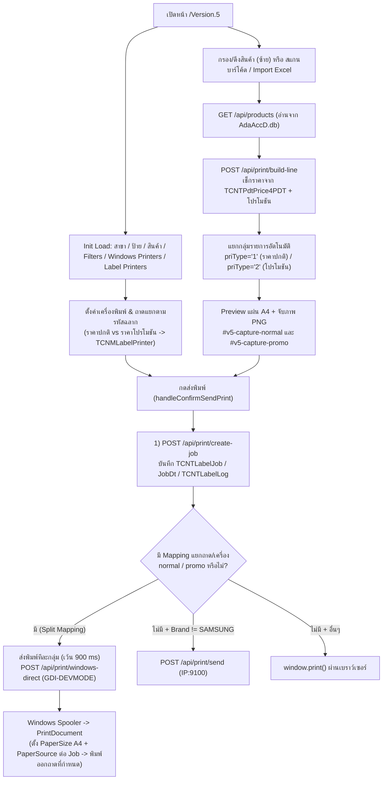

# สรุป Flow การทำงานระบบ AdaBarprint — Version 5 (`/Version.5`)

เอกสารนี้อ้างอิงจากโค้ดที่ทำงานจริงในปัจจุบัน (`src/main.tsx`, `src/pages/Version5Page.tsx`, `src/components/LabelPreview.tsx`, `backend-rust/src/main.rs`, `backend-rust/src/routes.rs`, `backend-rust/src/db.rs`)

---

## 1. สถาปัตยกรรมภาพรวม (System Architecture)

- **Frontend (React + Vite):** เข้าผ่าน URL `/Version.5` (`src/main.tsx` ตรวจ `pathname.toLowerCase()` เพื่อเปิด `Version5Page`)
- **Backend (Rust / Axum):** `adabarprint-server.exe` เปิดพอร์ต `http://127.0.0.1:3000` (หรือค่า `PORT`) และเสิร์ฟไฟล์ Build Frontend ในตัว
- **Database (SQLite 2 ก้อน):**
  1. `db/AdaAccD.db` (**Read-Only** `mode=ro`): ข้อมูลหลักสินค้า บาร์โค้ด ราคา และเอกสารโปรโมชันจากระบบ POS
  2. `db/custom.db` (**Read/Write** `mode=rwc`): ข้อมูลขนาดฉลาก (`TCNMLabelSize`), การผูกเครื่องพิมพ์/ถาด (`TCNMLabelPrinter`, `TCNMPrinterServer`), และประวัติการพิมพ์ (`TCNTLabelJob`, `TCNTLabelJobDt`, `TCNTLabelLog`)
- **Print Subsystem (Windows):** ดึงรายการเครื่องพิมพ์/ถาดจาก Windows Spooler ผ่าน PowerShell และส่งพิมพ์จริงด้วยโหมด **`GDI-DEVMODE`** (`System.Drawing.Printing.PrintDocument`)

---

## 2. ลำดับการทำงานแต่ละขั้นตอน (Step-by-Step Flow)

### ขั้นที่ 1: โหลดข้อมูลเริ่มต้น (`useEffect init` ใน `Version5Page.tsx`)
เมื่อเข้า `/Version.5` ระบบเรียก API พร้อมกัน 6 เส้น:
1. `GET /api/branches` — รายชื่อสาขา
2. `GET /api/label-sizes` — ขนาด/รูปแบบป้ายจาก `TCNMLabelSize` (รวมป้าย UFM ทั้ง 4 แบบที่ `ensure_ufm_label_sizes` สร้าง/อัปเดตให้)
3. `GET /api/products?limit=200` — รายการสินค้าเบื้องต้นจาก `AdaAccD.db`
4. `GET /api/filters/master` — กลุ่มสินค้า, ประเภท, ยี่ห้อ, รุ่น, กลุ่มราคา (`PriceGroup`), ตัวแทน (`Agency`)
5. `GET /api/printers/windows` — สแกนเครื่องพิมพ์ที่ติดตั้งจริงใน Windows (`[System.Drawing.Printing.PrinterSettings]::InstalledPrinters`) พร้อมกรองถาดเสริมที่ไม่ได้ติดตั้ง (`Get-PrinterProperty` เช็ก `OptTray* = FALSE`)
6. `GET /api/label-printers` — ดึงการจับคู่เครื่องพิมพ์/ถาดของแต่ละรหัสฉลากจาก `TCNMLabelPrinter` ใน `db/custom.db`

> **หมายเหตุเรื่อง Dropdown `* เครื่องพิมพ์ (Printer)` ด้านบนหน้าจอ:**  
> รายชื่อใน Dropdown รวมรายการเดิมจาก `localStorage` คีย์ `printbar_printers` (เช่นค่าเดิมที่เคยบันทึก `(172.16.30.196:9100)`) เข้ากับเครื่องพิมพ์ที่สแกนได้จาก Windows (`/api/printers/windows` จะแสดงเป็น `(Windows:9100)`) ส่วนการส่งพิมพ์จริงแบบแยกถาดจะยึดค่าที่ตั้งไว้ใน `TCNMLabelPrinter` เป็นหลัก

---

### ขั้นที่ 2: การตั้งค่าเครื่องพิมพ์และถาดกระดาษแยกปกติ / โปรโมชัน
ผู้ใช้กดเปิด Modal **ตั้งค่าเครื่องพิมพ์/ถาด** (List + Edit ใน Dialog เดียวกัน):
- เลือกเครื่องพิมพ์และถาดกระดาษแยกสำหรับ:
  - **ราคาปกติ (`FTLbpPriType = '1'`)**
  - **ราคาโปรโมชัน (`FTLbpPriType = '2'`)**
- กด **บันทึก**: เรียก `POST /api/label-printers` บันทึกลงตาราง `TCNMLabelPrinter` (`db/custom.db`) ผูกตาม `FTLbsCode` + `FTPsvCode` (`LOCAL`)
- กด **ทดสอบพิมพ์**: เรียก `POST /api/print/windows-direct` (`testMode: true`) เพื่อพิมพ์ใบ Test Print ออกไปยังเครื่องและถาดที่เลือก

---

### ขั้นที่ 3: การนำสินค้าเข้าตารางรายการพิมพ์ และคำนวณราคา/โปรโมชัน
ทำได้ 3 ช่องทางหลัก:
1. **แผงเงื่อนไขด้านซ้าย -> กด `แสดงข้อมูล` (`handleMoveDataIntoTable`):**
   - ส่งตัวกรอง (`pdtFrom/To`, `grpFrom/To`, `typeFrom/To`, `brandFrom/To`, `modelFrom/To`, `bchFrom/To`, `docNoFrom/To`, `docDateFrom/To`, `priceGroup`, `agency`, `effectiveDate`, `priceType`) ไปยัง `GET /api/products` (จำกัดสูงสุด 100 รายการต่อครั้ง)
   - นำแต่ละรายการไปเรียก `POST /api/print/build-line`
2. **สแกนบาร์โค้ด (`handleScanBarcodeEnter` / Scan/Browse Dialog):**
   - ค้นหาสินค้าด้วย `GET /api/products?keyword=...` แล้วคำนวณผ่าน `POST /api/print/build-line`
3. **นำเข้าไฟล์ Excel (`handleExcelFileUpload`):**
   - อ่านรายการบาร์โค้ด/จำนวนจากไฟล์แล้วส่งแต่ละแถวไปคำนวณผ่าน `POST /api/print/build-line`

#### การคำนวณภายใน `POST /api/print/build-line` (`routes.rs`)
1. ค้นข้อมูลสินค้า/หน่วย/แบรนด์/หมวด จาก `AdaAccD.db` (`TCNMPdtBar`, `TCNMPdt`, `TCNMPdt_L`, `TCNMPdtUnit_L`, `TCNMPdtBrand_L`, `TCNMPdtGrp_L`, `TCNMPdtPackSize`)
2. ค้นราคาขายตามสาขา/กลุ่มราคา (`FTPplCode`) และวันที่ที่มีผล (`effectiveDate`) จาก `TCNTPdtPrice4PDT` (ถ้าไม่มี fallback ไป `TCNMPdtPackSize` และ `TCNMPdtPri` ใน `custom.db`)
3. ตรวจสอบโปรโมชัน ณ วันที่ `on_date` ด้วย `resolve_accd_promotion` (และ fallback `resolve_promotion` ใน `custom.db`) เพื่อแยกสถานะ:
   - **`isPromo = true`** -> กำหนด `priType = '2'` (ราคาโปรโมชัน) พร้อมช่วงวันที่และข้อความโปรโมชัน
   - **`isPromo = false`** -> กำหนด `priType = '1'` (ราคาปกติ)
   - หากผู้ใช้เลือกกรอง `Promotion` เฉพาะรายการที่เข้าเงื่อนไขโปรโมชัน จึงจะแสดงในตาราง

---

### ขั้นที่ 4: การจัดหน้า Preview A4 และเตรียมภาพก่อนส่งพิมพ์ (`LabelPreview.tsx`)
รายการที่เลือก (`selected = true`) จะถูกแยกกลุ่มอัตโนมัติตาม `priType`:
- **`normalRows`** (`priType !== '2'`) -> วาดลงซ่อน/พรีวิว `#v5-capture-normal`
- **`promoRows`** (`priType === '2'`) -> วาดลงซ่อน/พรีวิว `#v5-capture-promo`

รูปแบบป้าย UFM มาตรฐานในระบบ (`db.rs` / `LabelPreview.tsx`):

| รหัสฉลาก | ชื่อรูปแบบ | ขนาด (mm) | จัดวางต่อแผ่น A4 (`Col × Row`) | ลักษณะการแสดงผล |
|:---|:---|---:|---:|:---|
| `UFM-NOR-16` | UFM ป้ายราคาปกติ (16 ดวง/A4) | `49 × 70` | `4 × 4` (16 ดวง) | แถบเขียว "ราคาปกติ" |
| `UFM-SALE-8` | UFM ป้ายโปรโมชัน SALE (8 ดวง/A4) | `100 × 70` | `2 × 4` (8 ดวง) | โปรโมชัน = แดง `SALE`, ปกติ = เขียว |
| `UFM-PRO-A5` | UFM ป้ายโปรโมชันใหญ่ A5 | `200 × 142` | `1 × 2` (2 ดวง) | โปรโมชัน = แดง `安い!`, ปกติ = เขียว |
| `UFM-TIMESALE` | UFM ป้าย Time Sale! 50% OFF (4 ดวง/A4) | `200 × 70` | `1 × 4` (4 ดวง) | โปรโมชัน = แดง `Time Sale!`, ปกติ = เขียว |

> ป้ายทุกแบบใช้ `boxSizing: 'border-box'` และปรับขนาดฟอนต์อัตโนมัติตามความยาวข้อความ รวมถึงซ่อนทศนิยม `.00` บนป้าย `UFM-PRO-A5`

---

### ขั้นที่ 5: บันทึกงานพิมพ์และส่งพิมพ์จริง (`handleConfirmSendPrint`)
เมื่อผู้ใช้กดปุ่มยืนยันพิมพ์:

1. **บันทึก Job ลง Database (`POST /api/print/create-job`):**
   - บันทึกหัวงานลง **`TCNTLabelJob`**
   - บันทึกรายละเอียดรายดวงลง **`TCNTLabelJobDt`** (คำนวณ `FNLjdBarSeq`, `FNLjdPage`)
   - บันทึกสรุปจำนวนดวง/หน้า และชื่อเครื่องพิมพ์+ถาดปลายทาง แยกปกติ/โปรโมชัน ลง **`TCNTLabelLog`**
2. **ส่งพิมพ์แยกปลายทาง (`hasSplitMapping = true`):**
   - แยกคิวส่งเป็น `dispatches`:
     - คิว **ราคาปกติ** (จับภาพจาก `#v5-capture-normal` ด้วย `capturePagesToPngBase64`)
     - คิว **ราคาโปรโมชัน** (จับภาพจาก `#v5-capture-promo` โดยหน่วงเวลา `900 ms` ก่อนส่งคิวถัดไป)
   - แต่ละคิวเรียก **`POST /api/print/windows-direct`**
3. **กลไกส่งพิมพ์ Windows Direct (`post_windows_direct_print` ใน `routes.rs`):**
   - ป้องกันส่งชนกันด้วย Mutex (`WINDOWS_PRINT_LOCK`)
   - รัน PowerShell (`-STA`) สร้างอ็อบเจกต์ `System.Drawing.Printing.PrintDocument` โหมด **`GDI-DEVMODE`**:
     - ตั้งค่าขนาดกระดาษ **`A4`**
     - แมตช์ชื่อถาดที่เลือกเข้า `PaperSources` (`RawKind`) และกำหนดลง `DEVMODE` ทั้ง `PrinterSettings.DefaultPageSettings.PaperSource`, `DefaultPageSettings.PaperSource` และ event `QueryPageSettings` ต่อหน้าโดยตรง (ไม่ยุ่ง `PrintConfiguration` ส่วนกลาง จึงไม่เกิด Race Condition)
     - สำหรับ **เครื่องพิมพ์จริง**: วาดภาพ PNG ด้วยคุณภาพ `HighQualityBicubic` จัดกึ่งกลางภายใน `Graphics.VisibleClipBounds` โดยเว้นขอบปลอดภัย `safePad = 6.25` (`1/100 inch`)
     - สำหรับ **เครื่องพิมพ์ PDF เสมือน** (`Microsoft Print to PDF`, `XPS`, `Adobe PDF`): พิมพ์ลงไฟล์ในโฟลเดอร์ `exports/` เต็มหน้า `e.PageBounds`
4. **กรณีไม่ได้ตั้งค่า Split Mapping:**
   - ถ้าเครื่องที่เลือกไม่ใช่ `SAMSUNG` -> ส่งตรงผ่าน `POST /api/print/send` (TCP Socket `IP:9100`)
   - นอกนั้น -> เรียก `window.print()` ผ่าน Browser

---

## 3. สรุป API Endpoints หลักที่ใช้งานใน Version 5

| Method & Path | หน้าที่ | แหล่งข้อมูลหลัก |
|:---|:---|:---|
| `GET /api/branches` | โหลดรายชื่อสาขา | `AdaAccD.db` / `custom.db` |
| `GET /api/filters/master` | โหลดตัวเลือก Filter ทั้งหมด | `AdaAccD.db` / `custom.db` |
| `GET /api/label-sizes` | โหลดรูปแบบและขนาดป้าย | `custom.db` (`TCNMLabelSize`) |
| `GET /api/printers/windows` | สแกนเครื่องพิมพ์ & ถาดที่ติดตั้งใน Windows | Windows Print Spooler |
| `GET/POST /api/label-printers` | อ่าน/บันทึก การผูกเครื่อง+ถาดแยกปกติ/โปรโมชัน | `custom.db` (`TCNMLabelPrinter`) |
| `GET /api/products` | ค้นหา/กรองสินค้าตามเงื่อนไขและเอกสาร | `AdaAccD.db` |
| `POST /api/print/build-line` | คำนวณราคา, ตรวจสอบโปรโมชัน, เลือกเทมเพลต | `AdaAccD.db` + `custom.db` |
| `POST /api/print/create-job` | บันทึก Job, Detail, และ Log การพิมพ์ | `custom.db` (`TCNTLabel*`) |
| `POST /api/print/windows-direct` | ส่งพิมพ์ตรงเข้า Windows Driver แยกถาด (`GDI-DEVMODE`) | Windows `PrintDocument` |
| `POST /api/print/send` | ส่งพิมพ์ผ่าน Network Raw Socket (เช่น Zebra/Thermal) | TCP `IP:Port` |
